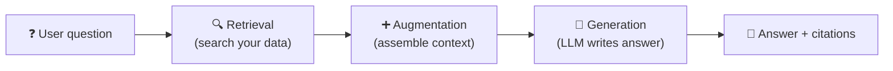
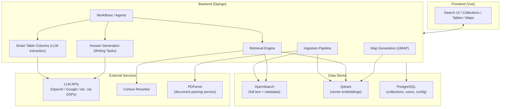
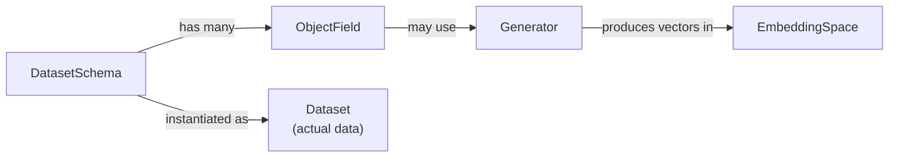
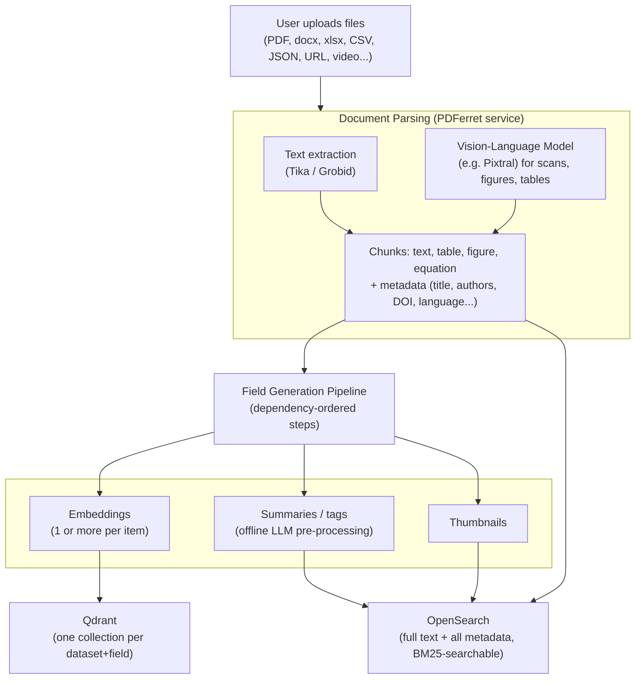
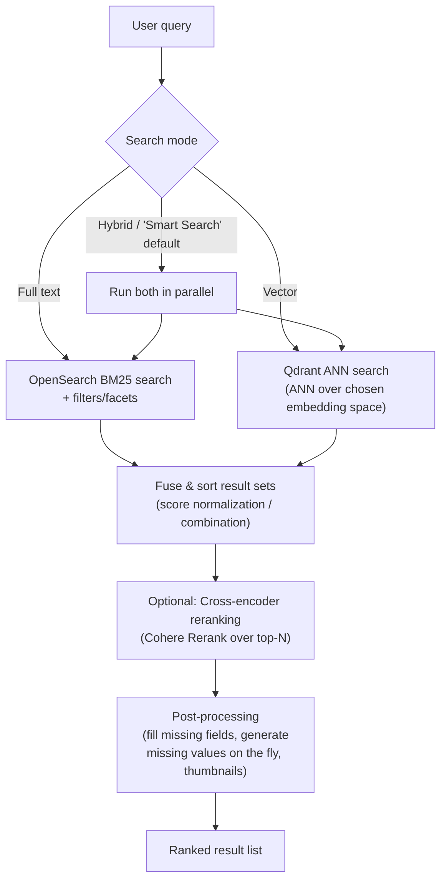
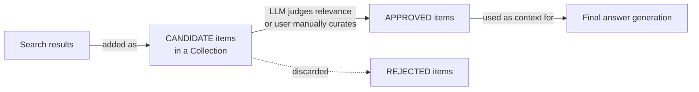
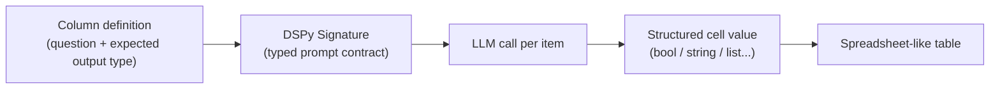
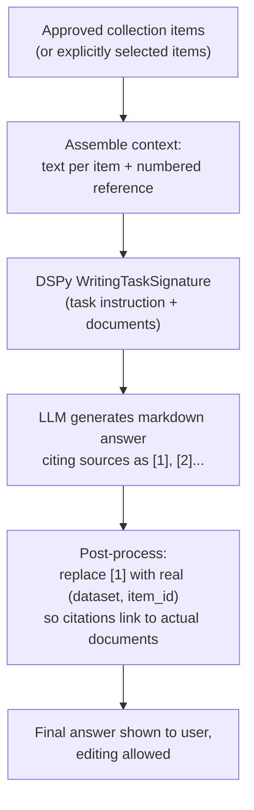
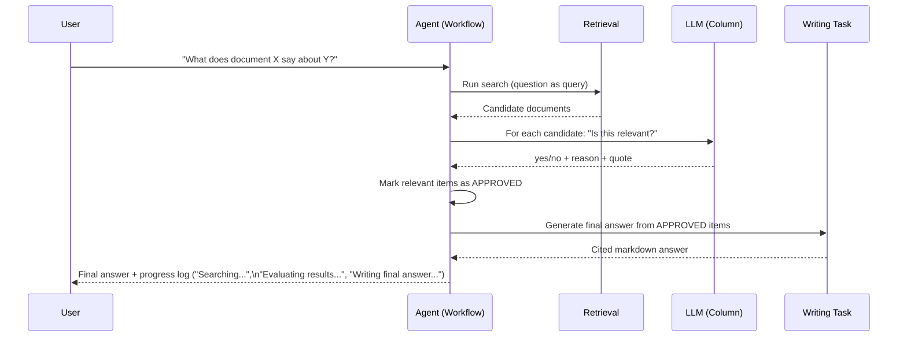
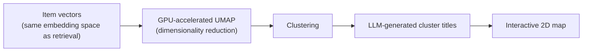

# InsightHub as a Case Study: How a Modern RAG Application Really Works

*A teaching-oriented walkthrough of this codebase, meant as the basis for a lecture/presentation on
Retrieval-Augmented Generation (RAG). Written to be read top to bottom like slides: each `##` section
is roughly one slide/topic.*

> For the terse, engineer-facing version of some of these diagrams, see [architecture.md](architecture.md).
> This document is broader (covers the whole app, not just search) and more explanatory.

---

## 1. Why RAG? The problem this app solves

A large language model (LLM) only "knows" what was in its training data, and it hallucinates when asked
about specific documents it has never seen (a company's internal PDFs, a set of scientific papers, a
person's own uploaded files).

**RAG = Retrieval-Augmented Generation.** Instead of asking the LLM to answer from memory, the app:

1. **Retrieves** the most relevant pieces of *your* data (documents, chunks, rows) for a question.
2. **Augments** the LLM prompt with those pieces as context.
3. **Generates** an answer that is grounded in that context, ideally with citations back to the source.

InsightHub is a good teaching example because it doesn't hide this behind a single "chat box" — every
step (retrieval, ranking, filtering, LLM extraction, final answer) is a **separate, inspectable,
user-editable stage**. That's rare, and it's exactly what makes the internals worth studying.



---

## 2. High-level architecture



**Key idea:** ingestion and retrieval are *decoupled* from "what do we do with the results" (the
workflows/agents layer). The same retrieval engine powers a simple search box, a spreadsheet-style
table extraction feature, a data map, and a RAG chat — they're just different consumers of the same
building blocks.

---

## 3. Data model: how data is described, not just stored

Before ingestion can happen, the system needs to know *what kind of data* it's dealing with. This is
the **Data Schema** concept:

- **`DatasetSchema`** — describes an entity type (e.g. "scientific paper", "tender", "product").
  Defines its `ObjectField`s (title, abstract, full text, embeddings, tags, thumbnail, etc.) and how
  results should be rendered in the UI.
- **`ObjectField`** — one field of that schema. Can be a plain field (given at import time) or a
  **generated field** (computed automatically, e.g. an embedding, a summary, or a translation).
- **`Generator`** — a pluggable function that computes a generated field. Some require *context*
  (e.g. "generate a cluster title" needs other documents), some require *multiple input fields*
  (e.g. "generate embedding from title + abstract").
- **`EmbeddingSpace`** — describes one embedding model's output (identifier, dimensions). A single
  document can have **several embeddings** (e.g. one from title+abstract, one from full text chunks,
  one from an image) — this is *not* the common "one vector per document" simplification.
- **`Dataset`** — an actual collection of items following a `DatasetSchema` (e.g. "AbsClust papers",
  "Company X tenders").



**Why this matters pedagogically:** most RAG tutorials assume a fixed pipeline
(chunk → one embedding → one vector DB). Here, adding a *new kind of embedding* or a *new generated
field* (say, an LLM-generated tag) doesn't require re-architecting the database — you declare a new
`ObjectField` + `Generator`, and a dependency-resolving pipeline (see next section) figures out how
and when to compute it.

---

## 4. Ingestion pipeline



Notable design choices:

- **Parsing is a separate service (PDFerret)**, so heavy document-understanding (VLMs, OCR, table/figure
  detection) doesn't block the main backend, and can scale/GPU independently.
- **The generation pipeline resolves dependencies automatically.** Each `ObjectField` declares its
  `source_fields`; the pipeline topologically sorts fields into phases so e.g. "embedding of summary"
  runs only after "summary" is generated. This is the mechanism that lets you add new embedding types
  or metadata fields *at runtime* without a data migration.
- **Two storage engines, one per concern:** OpenSearch holds text + structured metadata (good at
  keyword/BM25 + filters/facets); Qdrant holds vectors (good at ANN similarity search). Each vector
  field gets its own Qdrant collection, named after the dataset and field — so a document's title
  embedding and full-text-chunk embeddings live in separate, independently-queryable collections.

---

## 5. Retrieval: hybrid search, not just "vector search"

This is the "R" in RAG, and it's the most nuanced part of the system. A naive RAG demo does
`embed(query) -> cosine similarity -> top k`. This app does more:



Extra things students should notice:

- **Retrieval is pluggable per data source.** The same search entry point can also query external
  sources live (web search via Bing, Semantic Scholar API, a classifieds API) instead of, or in
  addition to, the internal databases — same downstream pipeline (ranking, LLM steps) applies either way.
- **Reranking is a second, more expensive but more accurate model** (a cross-encoder) applied only to
  the top-N candidates from the cheap first-stage retrieval — the classic "retrieve cheap, rerank
  precisely" pattern, with results cached to control cost/latency.
- **Query rewriting**: before searching, an LLM call can rewrite the user's natural-language question
  into a better search query (and even into the target language) — a small "agentic" step *before*
  retrieval even starts.
- Every scored item keeps an **`_origins` trail** (which stage — text match, vector match, rerank —
  produced which score). This is what "explainability" means in this codebase: you can show a user
  (or a student!) *why* a specific result ranked where it did.

---

## 6. From results to answer: Collections, Relevance, and the "funnel"

Search results alone aren't a RAG answer. The app models this as a **Collection** — a working set of
items with a per-item **relevance state**:

```
REJECTED_BY_USER (-2) — REJECTED_BY_AI (-1) — CANDIDATE (0) — APPROVED_BY_AI (1) — APPROVED_BY_USER (2)
```

This is the funnel described in the README: *"from massive data amounts to a curated set of items with
extracted information"*.



This explicit, persisted relevance state is what separates this from a stateless "RAG pipeline
function call" — a Collection is a durable, inspectable, resumable object a user (or an agent) can
keep working on.

---

## 7. Smart Table Columns: structured LLM extraction

Instead of (or in addition to) a chat answer, the app can add **columns** to a collection, each backed
by an LLM call per item:

- A column has an `expression` (the question/instruction), a `field_type` (string, boolean, list, ...),
  and `source_fields` telling it *which* text (title? full text snippets? both?) to feed the LLM.
- Structured prompting is done via **DSPy `Signature`s** — typed input/output contracts for LLM calls
  (e.g. `RelevanceSignature` has `document`, `criterion` in, `fulfilled: bool`, `reason`,
  `supporting_quote` out). This makes LLM calls testable/composable like normal functions instead of
  raw string templates.
- Columns can run automatically for every new search candidate (`auto_run_for_candidates`), which is
  exactly how an agent does per-item relevance judging (see §9).



This is the same mechanism used both for "Smart Tables" (visible to the user as a table) and, under the
hood, for an agent that needs to judge "is this document relevant?" for every candidate.

---

## 8. Generation: turning approved documents into a cited answer

The final "G" in RAG happens in a **Writing Task**:



Design details worth highlighting to students:

- The prompt **explicitly instructs the model** to only use information present in the documents, to
  say so if the answer isn't there, to flag conflicting info, and to cite the source document by
  number — a concrete, minimal example of *grounding + citation* instructions in a system prompt.
- Reference numbers `[1]` are placeholders during generation; **after** generation they're rewritten to
  point at the actual dataset/item IDs. This decouples "what the LLM sees" (small numbers, cheap
  tokens) from "what the user needs" (clickable references to real documents).
- **Answers are editable.** The RAG output isn't a black box; the user can tweak the generated text,
  and previous versions are kept — treating the LLM as a *drafting assistant*, not a final authority.

---

## 9. Agentic RAG: composing the pieces autonomously

All the pieces above (search → column-based judging → writing task) are exposed as **building blocks**
that a "Workflow" can chain together. `ResearchAgentWorkflow` is a clean, minimal example of an
agentic RAG loop:



Points worth discussing in class:

- This is a **deterministic, hand-authored agent loop** (search → judge → write), not a free-form
  "LLM calls tools in a loop until it decides to stop" ReAct-style agent. It trades some flexibility for
  predictability, debuggability, and cost control — a very common real-world compromise vs. the more
  "autonomous" agent designs often shown in demos.
- Every step updates a **visible progress/explanation log** (`current_agent_step`,
  `log_explanation(...)`) — the UI shows the user *what the agent is doing right now*, which matters a
  lot for trust in production agentic systems.
- Because search, judging, and writing are all independent building blocks with stable interfaces, more
  sophisticated workflows (multi-step iterative search, query reformulation, multi-hop QA) can be built
  by recombining them — the codebase has stubs (`WorkflowCategory`, `available_workflows/`) for exactly
  this kind of extension.

---

## 10. Bonus: the same retrieval engine powers a non-text feature — visual maps

Not RAG itself, but a great illustration of "embeddings are a general-purpose representation, not just
a RAG implementation detail": the same vectors used for retrieval can be **dimensionality-reduced
(UMAP)** and plotted as an interactive 2D map, with clusters auto-labeled by an LLM. This reuses the
exact same embedding spaces and Qdrant collections as retrieval — no separate pipeline needed.



---

## 11. Suggested narrative for the talk

A possible flow for presenting this to students, tying back to §1:

1. **Motivate RAG** — why can't we just ask ChatGPT about our own documents? (§1)
2. **Show the data model first** — RAG needs *retrievable* data; explain schemas/fields/embeddings as
   "the thing you retrieve *from*". (§3)
3. **Walk ingestion → hybrid retrieval → reranking** as the "R" (§4-5), emphasizing this is *not* just
   cosine similarity — it's BM25 + vectors + reranking + explainability.
4. **Introduce Collections & relevance as the funnel** connecting retrieval to generation (§6).
5. **Show Smart Table Columns as "RAG applied per-item"** — a nice bridge concept before jumping to
   full-document generation (§7).
6. **Show Writing Tasks as the "G"** — grounding instructions + citation remapping (§8).
7. **Close with the agent example** — tie R + A + G together into one autonomous loop, and discuss the
   "hand-authored agent vs. free-form ReAct agent" design tradeoff (§9).
8. **Optional bonus** — embeddings aren't just for RAG; show the map feature to broaden the concept of
   "what you can do with a retrieval-ready dataset" (§10).

---

## Where to point students in the code (no need to open during the talk, but useful for Q&A)

| Concept | Key files |
| --- | --- |
| Data schema / generated fields | `backend/data_map_backend/models.py` (`DatasetSchema`, `ObjectField`, `Generator`, `EmbeddingSpace`) |
| Ingestion / parsing | `backend/ingest/logic/pdferret_client.py`, `backend/ingest/logic/*` |
| Field generation pipeline | `backend/legacy_backend/logic/extract_pipeline.py` |
| Hybrid retrieval | `backend/legacy_backend/logic/search.py`, `search_common.py` |
| Reranking | `backend/legacy_backend/logic/reranking.py` |
| Vector store client | `backend/legacy_backend/database_client/vector_search_engine_client.py` (Qdrant) |
| Text store client | `backend/legacy_backend/database_client/text_search_engine_client.py` (OpenSearch) |
| Collections / relevance funnel | `backend/data_map_backend/models.py` (`DataCollection`, `CollectionItem`), `schemas.py` (`ItemRelevance`) |
| Smart Table columns (structured LLM extraction) | `backend/columns/logic/llm_column.py` |
| Answer generation ("Writing Task") | `backend/write/logic/writing_task.py` |
| Agentic workflow example | `backend/workflows/available_workflows/agents/research_agent.py` |
| Question-answering workflow (single/multi doc) | `backend/workflows/available_workflows/question_workflows.py` |
| Visual maps (UMAP) | `backend/map/logic/map_generation_pipeline.py` |
